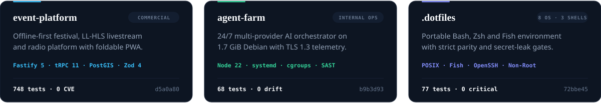

<picture>
  <source media="(prefers-color-scheme: dark)" srcset="./assets/hero-dark.svg">
  <source media="(prefers-color-scheme: light)" srcset="./assets/hero-light.svg">
  
</picture>

 

Systems and full-stack software engineer bridging low-level Linux and network fundamentals (**Hive Helsinki**) with 15 years of business operations and modern, security-hardened delivery (**Ervice Oy**). Open to freelance engagements, fixed-scope contracts, and full-time roles — negotiated case-by-case via **[LinkedIn](https://linkedin.com/in/erkka-ala-lahti/)**.

 

<picture>
  <source media="(prefers-color-scheme: dark)" srcset="./assets/metrics-dark.svg">
  <source media="(prefers-color-scheme: light)" srcset="./assets/metrics-light.svg">
  
</picture>

 

### Selected Systems

<picture>
  <source media="(prefers-color-scheme: dark)" srcset="./assets/systems-dark.svg">
  <source media="(prefers-color-scheme: light)" srcset="./assets/systems-light.svg">
  
</picture>

 

Private Ervice Oy repositories — full source walkthroughs and live demonstrations available on request. Public C/C++, Docker, and full-stack projects from Hive Helsinki are pinned below.

Live repository ledger (auto-synced)

 

<!-- AUTO-STATUS:START -->
| Repository       | Visibility | Commit                 | Files | Tests     | Security               |
| :--------------- | :--------- | :--------------------- | ----: | :-------- | :--------------------- |
| `event-platform` | Private    | `d5a0a80` (2026-11-22) |   189 | 748 tests | Rule 31 · SAST · 0 CVE |
| `agent-farm`     | Private    | `b9b3d93` (2026-11-22) |    99 | 68 tests  | SAST · 0 drift         |
| `.dotfiles`      | Private    | `72bbe45` (2026-11-22) |    69 | 77 tests  | Parity · secret scan   |

*Auto-synced 2026-11-22 (24 active models across 4 providers).*
<!-- AUTO-STATUS:END -->

<!-- AUTO-COLLAB:START -->
<!-- AUTO-COLLAB:END -->

---

### Core Stack

| Domain | Technologies & Practice |
| :--- | :--- |
| **Systems & Linux** | C, C++, Debian, openSUSE, Arch, Alpine, NixOS, `systemd`, `cgroups`, Docker, NGINX, Tailscale, Bash / Zsh / Fish |
| **Full-Stack & Data** | TypeScript, Node.js, Fastify 5, tRPC 11, Zod 4, PostgreSQL + PostGIS, Drizzle ORM, React, Next.js, Offline PWA |
| **Security & Quality** | TLS 1.3 / PKI, OWASP ASVS L3, Fail-Closed Auth (`timingSafeEqual`), HMAC, SSRF Guards, OpenSSH, GnuPG, SAST & Drift Gates |
| **AI & Delivery** | Governed multi-model pipelines (24 models, 4 providers), customer data migrations (TableOnline), 40+ city rollouts (Koutsit), IT lead (FSE Tanzania) |

---

  Helsinki, Finland &middot; Finnish (Native), English (Professional) &middot; <a href="https://linkedin.com/in/erkka-ala-lahti/">Connect on LinkedIn</a>

