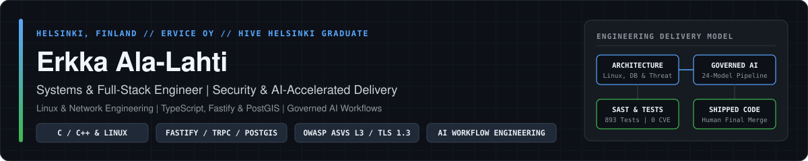

<picture>
  <source media="(prefers-color-scheme: dark)" srcset="./assets/hero-dark.svg">
  <source media="(prefers-color-scheme: light)" srcset="./assets/hero-light.svg">
  
</picture>

Helsinki, Finland &nbsp;&middot;&nbsp; [LinkedIn](https://linkedin.com/in/erkka-ala-lahti/) &nbsp;&middot;&nbsp; Ervice Oy

---

### About

Hi, I'm Erkka — a software developer and IT specialist who actually likes working with people. After a long career in entrepreneurship and operational leadership, I graduated from **Hive Helsinki** to turn a lifelong passion for computers, operating systems, and problem-solving into a tech career.

Learning low-level systems programming (C, C++, Unix, networking) alongside the rise of modern AI tools gave me a practical advantage: I understand how systems work under the hood, and I actively use agentic AI workflows to automate work and ship clean, maintainable software faster. I work across **DevOps, systems administration, security, full-stack development, and AI automation** — primarily on Linux, and comfortably across **Windows** and **macOS** environments as well.

I am primarily interested in full-time engineering and IT roles, while remaining open to freelance projects and shorter-term contract work as well. For freelance engagements, I can operate through **Ervice Oy**.

---

### Tech Stack

**DevOps, Systems & Security**

**Full-Stack, Backend & Data**

**Languages & Shell**

**Operating Systems**

---

### Selected Systems & Projects

#### [Self-Hosted AI Engineering Platform](./docs/agent-farm.md) *(Private — Ervice Oy)*
Zero-npm-dependency **Node.js** multi-model orchestration and telemetry platform running continuously on self-hosted Debian hardware (`systemd`, `cgroups`, `zram`, TLS, Tmux web terminal). Coordinates LLM providers behind deterministic SAST, secret-scanning, language, and anti-bloat checks with human approval before every merge. [Read architecture overview](./docs/agent-farm.md).

#### [Event & Streaming Platform](./docs/event-platform.md) *(Private — Ervice Oy)*
Full-stack multi-tenant TypeScript monorepo (**Fastify**, **tRPC**, **Zod**, **PostgreSQL/PostGIS**, **Drizzle ORM**, **MediaMTX**) combining an offline-first foldable festival PWA, low-latency ticketed LL-HLS video streams, and background radio — built with Fail-Closed admin auth, constant-time HMAC tokens, and SSRF protection. [Read architecture overview](./docs/event-platform.md).

#### [Cross-Platform Shell & Security Environment (.dotfiles)](./docs/dotfiles.md) *(Private — Ervice Oy)*
Unified **Bash**, **Zsh**, and **Fish** configuration toolkit engineered for consistent feature parity and non-root portability across Linux distributions, macOS, and Termux, backed by OpenSSH/GnuPG defaults and automated parity and secret-leak tests. [Read overview](./docs/dotfiles.md).

#### [hive-inception](https://github.com/erkkaervice/hive-inception) *(Public · Docker / NGINX)*
Multi-container infrastructure (**NGINX**, **WordPress**, **MariaDB**) built from base Alpine/Debian images with TLS termination, persistent volumes, and isolated networks.

#### [hive-webserv](https://github.com/erkkaervice/hive-webserv) *(Public · C++)*
From-scratch **HTTP/1.1** server built in C++ without frameworks, focused on RFC protocol compliance, non-blocking sockets, and `poll`/`select` I/O multiplexing.

#### [hive-transcendence](https://github.com/erkkaervice/hive-transcendence) *(Public · TypeScript / Next.js)*
Real-time multi-user SPA with centralized authentication and containerized backend (**TypeScript**, **Next.js**, **MariaDB**, **Docker**), delivered while serving as Product Owner.

*Source walkthroughs and live demonstrations of private Ervice Oy systems are available during technical interviews.*

<!-- AUTO-COLLAB:START -->
<!-- AUTO-COLLAB:END -->

---

### Background & Community IT

**System Rollouts, Onboarding & Operations** — Supported customer system migrations, onboarding, account configuration, data validation, and independent technical support (**TableOnline**). Coordinated nationwide digital kitchen management system rollouts and user training (**Koutsit**), alongside founding and leading businesses across hospitality, events, coaching, and manufacturing.

**IT Specialist & Vice Board Member (FSE Tanzania)** — Manage end-to-end IT infrastructure for a charity supporting disabled students in Tanzania (Moodle server, WordPress sites, web hosting, Netvisor and Paytrail integrations) and develop an on-site information security training program.

**Education** — Graduate of **Hive Helsinki** (peer-to-peer software engineering academy; Product Owner for the final project) and **Tampere University of Applied Sciences** (Bachelor of Hospitality Management).

---

### Contact

- **Availability:** Primarily seeking full-time roles across **DevOps, Systems Administration, Security, Full-Stack Development, and Agentic AI / Automation**; also open to freelance and short-term contract work (via **Ervice Oy**).
- **Primary Channel:** [LinkedIn](https://linkedin.com/in/erkka-ala-lahti/) *(GitHub serves as my technical portfolio; connect on LinkedIn for roles and collaborations)*.
- **Languages:** Finnish (Native), English (Professional), Swedish & Spanish (Conversational / Basic).
