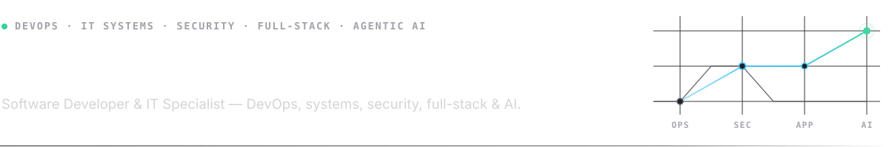

  <picture>
    <source media="(prefers-color-scheme: dark)" srcset="./assets/header-dark.svg">
    <source media="(prefers-color-scheme: light)" srcset="./assets/header-light.svg">
    
  </picture>
  

    Helsinki, Finland &middot;
    <a href="https://linkedin.com/in/erkka-ala-lahti/">LinkedIn</a> &middot;
    Ervice Oy
  

---

### Professional Profile

I bridge the gap between complex technical infrastructure and pragmatic business requirements. Following an extensive career in entrepreneurship and operational leadership, I graduated from **Hive Helsinki** to turn a lifelong passion for Linux and systems engineering into a profession.

I build hardened, reliable systems — from low-level network protocols and Linux infrastructure to full-stack TypeScript platforms and governed AI-assisted engineering workflows — always keeping functional reliability and real-world usability at the center. Operating through **Ervice Oy**, I am open to freelance engagements, contract assignments, and full-time engineering roles, negotiated case-by-case.

---

### Technical Skills

- **Languages:** C, C++, TypeScript, JavaScript, Python, SQL, Shell Scripting (Bash, Zsh, Fish)
- **Backend, Web & Databases:** Node.js, Fastify, tRPC, Zod, React, Next.js, PostgreSQL, PostGIS, Drizzle ORM, MariaDB, Prisma ORM
- **DevOps & Infrastructure:** Linux (Debian, openSUSE, Arch, Alpine, NixOS, Fedora), systemd, Docker, Docker Compose, NGINX, Tailscale, Git, GNU Make
- **Security & Quality:** OWASP ASVS, TLS & PKI, OpenSSH & GnuPG Hardening, Network Isolation, SAST & Secret Scanning, Automated Testing
- **Networking & Diagnostics:** TCP/IP, HTTP/1.1, Sockets, I/O Multiplexing, Subnetting, Routing, Wireshark, TCPDump, Nmap, Valgrind
- **AI & Workflow Automation:** Multi-model LLM orchestration, deterministic security and test guardrails, CI/CD automation

---

### Key Technical Projects

#### Event & Streaming Platform *(Private — Ervice Oy)*
*Full-Stack Architecture, Offline-First PWA & Live Media*
- **The Challenge:** Designing a resilient, multi-tenant event platform that works reliably without cellular coverage at festivals while also supporting low-latency ticketed video streams and continuous background radio.
- **The Solution:** Architected a TypeScript monorepo using **Fastify**, **tRPC**, **Zod**, **PostgreSQL/PostGIS**, **Drizzle ORM**, **MediaMTX**, and an offline-first foldable PWA, hardened with Fail-Closed admin authentication, constant-time HMAC signing, and SSRF protection.
- **Competency:** End-to-end TypeScript architecture, geospatial data modeling, media streaming pipelines, and OWASP-aligned security design.

#### Self-Hosted AI Engineering Platform *(Private — Ervice Oy)*
*Multi-Model Orchestration, Guardrails & Constrained-Hardware Operations*
- **The Challenge:** Accelerating software maintenance, testing, and refactoring using multiple LLM providers on constrained, self-hosted Debian hardware without compromising security or code quality.
- **The Solution:** Engineered a self-hosted **Node.js** orchestration and telemetry platform (`systemd`, `cgroups`, `zram`, TLS, Tmux web terminal) that coordinates multiple AI providers behind deterministic SAST, secret-scanning, path-containment, and drift-verification gates, with human review before every merge.
- **Competency:** Resilient Linux systems administration, AI workflow governance, defensive security automation, and real-time telemetry.

#### [.dotfiles](https://github.com/erkkaervice/.dotfiles)
*Cross-Platform Shell Parity & Environment Hardening*
- **The Challenge:** Maintaining identical security tooling, shell ergonomics, and non-root compatibility across disparate operating systems (Debian, openSUSE, Arch, Alpine, NixOS, Fedora, macOS, Termux).
- **The Solution:** Built a unified **Bash/Zsh** and **Fish** configuration ecosystem with **OpenSSH/GnuPG** hardening, responsive Tmux defaults, and automated parity and secret-leak test suites.
- **Competency:** Cross-platform Unix engineering, security-first configuration management, and test-driven shell automation.

#### [hive-webserv](https://github.com/erkkaervice/hive-webserv) *(Public)*
*Network Engineering & Protocol Implementation*
- **The Challenge:** Managing concurrent client connections and HTTP traffic without high-level frameworks.
- **The Solution:** Engineered a functional **HTTP/1.1** server in **C++** from scratch focusing on non-blocking sockets and I/O multiplexing (`poll`/`select`).
- **Competency:** RFC protocol adherence, socket programming, and low-level network performance.

#### [hive-transcendence](https://github.com/erkkaervice/hive-transcendence) *(Public)*
*Full-Stack Architecture & Real-Time Systems*
- **The Challenge:** Delivering a real-time, multi-user web application with centralized authentication and a containerized backend while coordinating team delivery.
- **The Solution:** Developed a Single Page Application using **TypeScript**, **Next.js**, **MariaDB**, and **Docker**, serving as **Product Owner** to drive shared architecture and execution.
- **Competency:** Full-stack integration, real-time synchronization, and technical team coordination.

#### [hive-inception](https://github.com/erkkaervice/hive-inception) *(Public)*
*Container Orchestration & System Administration*
- **The Challenge:** Orchestrating a secure, multi-tier web stack with persistent storage and strict network isolation.
- **The Solution:** Built a multi-container **Docker** infrastructure (**NGINX**, **WordPress**, **MariaDB**) from base Alpine/Debian images with TLS termination and isolated networks.
- **Competency:** Container hardening, network isolation, volume persistence, and service orchestration.

*Source walkthroughs and live demonstrations of private Ervice Oy systems are available during technical interviews.*

<!-- AUTO-COLLAB:START -->
<!-- AUTO-COLLAB:END -->

---

### Operational Seniority & Technical Pivot

**Business Operations & Rollouts**
Founded and led businesses across hospitality, events, coaching, and manufacturing. Coordinated nationwide digital kitchen management system rollouts (**Koutsit**) and executed customer migrations, account configuration, data validation, and independent technical support (**TableOnline**) — bridging software providers and end-users under operational pressure.

**Systems Engineering & Community IT**
Graduate of **Hive Helsinki**'s peer-to-peer curriculum, grounded in low-level C/C++ and Unix fundamentals. Also serve as Volunteer IT Specialist and Vice Board Member for **FSE**, managing end-to-end infrastructure (Moodle server, WordPress sites, web hosting, Netvisor and Paytrail integrations) and building an on-site information security training program for students in Tanzania.

---

### Contact & Collaboration

- **Availability:** Freelance via **Ervice Oy** — open to contract assignments and full-time roles in **Software Engineering, DevOps, or IT Infrastructure** (case-by-case).
- **Primary Channel:** [LinkedIn](https://linkedin.com/in/erkka-ala-lahti/) *(GitHub serves as my technical portfolio; connect on LinkedIn for roles and collaborations)*.
- **Languages:** Finnish (Native), English (Professional), Swedish & Spanish (Conversational / Basic).

---

  <h3>Core Tech Stack</h3>

  

    
    
    
    
    
    
    
    
    
  

  

    
    
    
    
    
    
    
    
    
    
  

  

    
    
    
    
    
    
    
    
    
  

  

    
    
    
    
    
    
    
    
    
    
  

  

    
    
    
    
    
    
    
    
    
    
  

