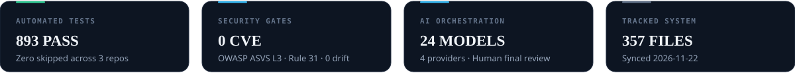
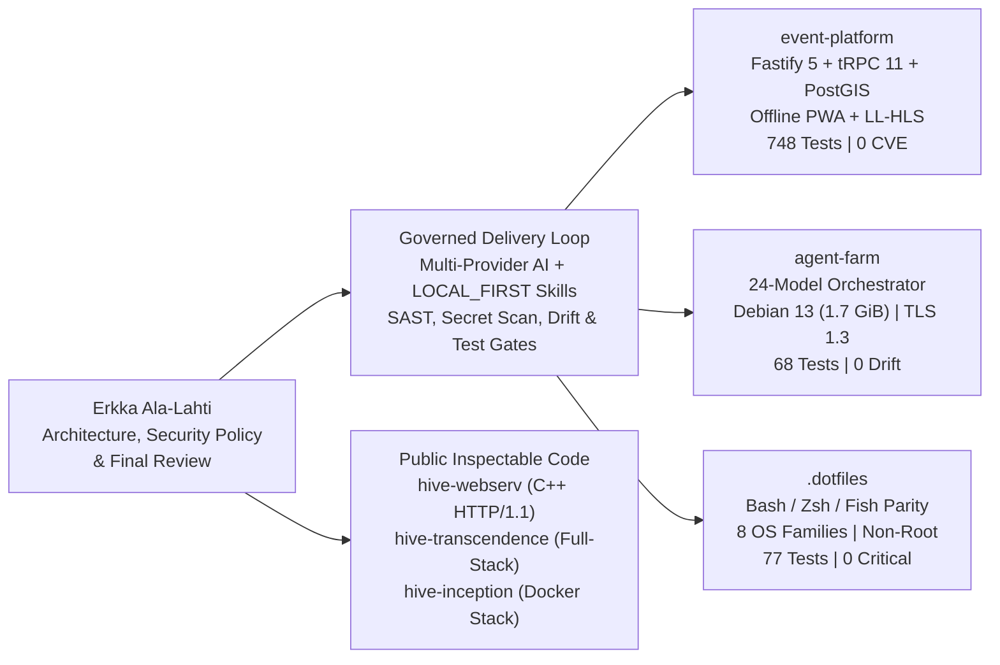

  <picture>
    <source media="(prefers-color-scheme: dark)" srcset="./assets/hero-dark.svg">
    <source media="(prefers-color-scheme: light)" srcset="./assets/hero-light.svg">
    
  </picture>

  
  
  
  

  <a href="#live-engineering-metrics">Metrics</a> &middot;
  <a href="#capabilities-tooling--proven-outcomes">Capabilities</a> &middot;
  <a href="#engineering-ecosystem">Ecosystem</a> &middot;
  <a href="#selected-systems--case-studies">Systems &amp; Projects</a> &middot;
  <a href="#operations--delivery-track-record">Delivery Track Record</a> &middot;
  <a href="#technical-stack">Tech Stack</a>

---

### Engineering Profile

Software developer and systems engineer combining low-level Linux and network fundamentals, full-stack TypeScript architecture, and governed AI engineering workflows with 15 years of operational and business leadership.

Graduated from **Hive Helsinki** (42 Network), where I built C/C++ network servers and Unix tooling from scratch without external libraries. Today, through **Ervice Oy**, I design and ship security-hardened web platforms, resilient Linux infrastructure, and multi-model AI automation pipelines that deliver tested software at high velocity without sacrificing reliability.

- **Role of this GitHub profile:** Technical proof-of-work, architecture catalog, and live-verified quality metrics.
- **How I work with teams:** Operating as a freelancer via **Ervice Oy** and open to **freelance engagements, fixed-scope contracts, and full-time engineering roles** — always negotiated case-by-case. For roles, projects, or live technical walkthroughs, connect on **[LinkedIn](https://linkedin.com/in/erkka-ala-lahti/)**.

---

### Live Engineering Metrics

  <picture>
    <source media="(prefers-color-scheme: dark)" srcset="./assets/metrics-dark.svg">
    <source media="(prefers-color-scheme: light)" srcset="./assets/metrics-light.svg">
    
  </picture>

<!-- AUTO-STATUS:START -->
| Repository       | Visibility             | Latest Commit          | Tracked Files | Automated Tests        | Security Gate             |
| :--------------- | :--------------------- | :--------------------- | ------------: | :--------------------- | :------------------------ |
| `event-platform` | Private (Commercial)   | `d5a0a80` (2026-11-22) |           189 | 748 tests (5 packages) | Rule 31 + SAST + 0 CVE    |
| `agent-farm`     | Private (Internal Ops) | `a46e96c` (2026-11-22) |            99 | 68 tests (node:test)   | SAST + SHA-256 0 drift    |
| `.dotfiles`      | Private (Public-Ready) | `72bbe45` (2026-11-22) |            69 | 77 parity & SAST tests | Multi-shell + secret scan |

*Auto-synced on 2026-11-22 by `agent-farm/scripts/readme-autosync.mjs` (24 active models across 4 providers).*
<!-- AUTO-STATUS:END -->

> Commercial and internal Ervice Oy repositories remain private to protect business logic and host configurations. Full source walkthroughs and live demonstrations are available during technical interviews. Publicly inspectable C/C++, Docker, and full-stack repositories are linked below.

---

### Capabilities, Tooling & Proven Outcomes

I treat modern AI models as high-leverage engineering infrastructure — paired with deep systems fundamentals, strict static analysis, automated test suites, and human architectural ownership.

| Focus Area | Core Tooling & Methods | Proven Outcomes |
| :--- | :--- | :--- |
| **Full-Stack & Offline-First Systems** | TypeScript, Node.js 22+, Fastify 5, tRPC 11, Zod 4, PostgreSQL 16 + PostGIS, Drizzle ORM, React, Next.js, Sub-5ms Brotli/Gzip SSR, Service Workers | Architected and delivered `event-platform` across 3 pilot verticals (offline festival bundles, ticketed LL-HLS streaming, background radio + foldable PWA) with **748 automated tests** and **0 production CVEs**. |
| **Linux Infrastructure & Networking** | Debian 13, openSUSE, Arch, Alpine, NixOS, `systemd`, `cgroups`/`zram`/`earlyoom`, Docker, NGINX, Tailscale VPN, TLS 1.3 PKI, C/C++ sockets (`poll`/`select`) | Engineered a 24/7 headless server on constrained hardware (Core 2 Duo, 1.7 GiB RAM) with 3-layer self-healing and sub-5ms TLS 1.3 telemetry; built an RFC HTTP/1.1 server from scratch in C++. |
| **Security-by-Design & Hardening** | OWASP ASVS L3, Fail-Closed auth (`timingSafeEqual`), HMAC token binding, SSRF/DNS-rebinding guards, binary EXIF/GPS stripping, OpenSSH, GnuPG, custom SAST & secret scanners | Enforced Fail-Closed Rule 31 API authentication, 28-pattern secret-leak scanning, symlink-safe write containment, and SHA-256 live-vs-Git drift verification across managed repositories. |
| **Governed AI Engineering & Automation** | Self-hosted multi-provider orchestration (Claude Code Pro, Gemini, Groq, GitHub Models), `LOCAL_FIRST` skill routing, adversarial review gates, CI/CD test verification | Built `agent-farm` to coordinate 24 models behind deterministic SAST, test, and drift gates with mandatory human final review — accelerating refactoring, test coverage, and documentation without vibe-coding risk. |
| **Rollouts, Migrations & Operations** | Data migration & validation, system onboarding, Moodle/WordPress/Netvisor/Paytrail administration, technical training, stakeholder alignment | Delivered customer migrations at **TableOnline (2026)**, led a **40+ city** digital system rollout (**Koutsit**), and manage end-to-end IT infrastructure and security training for **FSE Charity (Tanzania)**. |

---

### Engineering Ecosystem

---

### Selected Systems & Case Studies

#### Ervice Oy Ecosystem *(Private Repositories — Live Code & Demo Available on Request)*

| System | Stack & Runtime | Engineering Highlights |
| :--- | :--- | :--- |
| **`event-platform`** | TypeScript monorepo (`Fastify 5`, `tRPC 11`, `Zod 4`, `PostgreSQL 16 + PostGIS`, `Drizzle ORM`, `MediaMTX`, `SeaweedFS`) | Multi-tenant platform covering three real-world event profiles: offline-first music festivals (`ETag 304`, SHA-256 bundles, Haversine POI distance, `.ics` export), low-latency ticketed LL-HLS streams (constant-time HMAC tokens, zero-dep AWS SigV4 presigner), and continuous radio with foldable tabletop PWA layout and Wear OS glance state. Hardened with Fail-Closed Rule 31 `adminProcedure`, SSRF/DNS-rebinding protection, EXIF/GPS stripping, and **748 passing tests**. |
| **`agent-farm`** | Node.js 22+ ESM, `Debian 13`, `systemd`, `TLS 1.3`, `Python PTY`, `Three.js` | Self-hosted AI engineering platform running 24/7 on a 1.7 GiB RAM host with 3-layer resilience (`cgroups`/`zram`/`earlyoom`, 2-min self-heal timer, `softdog` watchdog). Orchestrates 24 models across 4 providers using deterministic guardrails (`agent-guards.mjs`), SHA-256 manifest drift gates, a single-port TLS 1.3 telemetry dashboard, and a mobile-responsive Tmux web terminal. **68 passing tests**, **0 drift**. |
| **`.dotfiles`** | `Bash`, `Zsh`, `Fish`, `OpenSSH`, `GnuPG`, `Tmux`, `node:test` | Portable shell and security toolkit enforcing strict command and exit-code parity across Bash/Zsh (`.sh_common`) and Fish (`.config.fish`) on 8 OS families (Debian, Arch, Fedora, NixOS, openSUSE, Alpine, macOS, Termux) with non-root `~/.local/bin` fallbacks, SSH agent hardening, and automated secret-leak checks. **77 passing tests**. |

#### Public Inspectable Foundations *(Hive Helsinki / 42 Network)*

| Repository | Focus Area | Engineering Scope |
| :--- | :--- | :--- |
| **[hive-webserv](https://github.com/erkkaervice/hive-webserv)** | Network & Protocol Engineering (`C++`) | Custom RFC-compliant HTTP/1.1 server built from scratch without frameworks, implementing non-blocking sockets and I/O multiplexing (`poll`/`select`). |
| **[hive-transcendence](https://github.com/erkkaervice/hive-transcendence)** | Full-Stack Web & Real-Time (`TypeScript`, `Next.js`, `MariaDB`, `Docker`) | Real-time multi-user web application with centralized authentication and containerized deployment; served as **Product Owner** coordinating team delivery. |
| **[hive-inception](https://github.com/erkkaervice/hive-inception)** | Container Infrastructure (`Docker Compose`, `NGINX`, `MariaDB`, `Alpine/Debian`) | Multi-container stack built from base images with strict network isolation, TLS termination, and persistent volumes. |

<!-- AUTO-COLLAB:START -->
<!-- AUTO-COLLAB:END -->

---

### Operations & Delivery Track Record

- **Customer Onboarding & Data Migration (TableOnline Finland Oy, 2026):** Executed customer system migrations, account configuration, data validation, and independent technical support during a full-time contract assignment.
- **Volunteer IT Specialist & Vice Board Member (FSE Charity, Tanzania Project, 2025-Present):** Manage end-to-end IT infrastructure including Moodle server administration, WordPress sites, web hosting, Netvisor/Paytrail integrations, and an on-site information security training package.
- **Nationwide System Rollout (Koutsit, 2024-2025):** Served as lead implementation trainer across **40+ cities** for a digital kitchen management system rollout, bridging software vendors and end-users under operational pressure.
- **Entrepreneurship & Operations (15 Years):** Built and operated companies across events, hospitality, coaching, and manufacturing (Ervice Oy, Pieni Limonaaditehdas Porvoo, Konseptihelsinki), bringing commercial pragmatism and clear communication to engineering teams.

---

### Technical Stack

**Languages & Shell**

**Backend, Data & Web**

**Infrastructure, DevOps & Security**

**Operating Systems & Environments**

---

  Finnish (Native) &middot; English (Professional) &middot; Swedish &amp; Spanish (Conversational/Basic) &middot; Connect via <a href="https://linkedin.com/in/erkka-ala-lahti/">LinkedIn</a>

