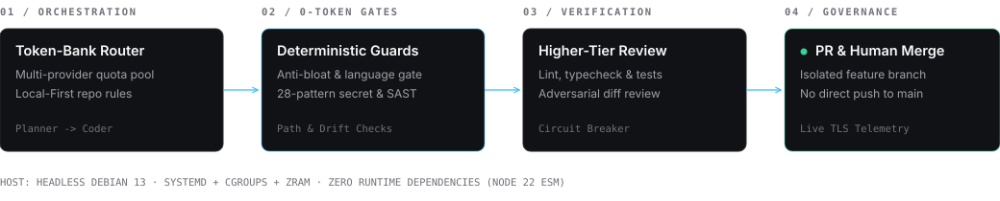

# Self-Hosted AI Engineering Platform — Architecture Overview

*Private repository — Ervice Oy (Helsinki, Finland)* · [Back to Profile](../README.md)

A zero-dependency Node.js orchestration, guardrail, and telemetry platform running continuously on constrained self-hosted Debian hardware (`systemd`, `cgroups`, `zram`). It accelerates code maintenance, testing, and refactoring across repositories while enforcing strict deterministic safety boundaries before any pull request is opened.

<picture>
  <source media="(prefers-color-scheme: dark)" srcset="../assets/arch-agent-farm-dark.svg">
  <source media="(prefers-color-scheme: light)" srcset="../assets/arch-agent-farm-light.svg">
  
</picture>

## Key Engineering Capabilities

- **Multi-Provider Quota Routing:** Coordinates models across multiple providers with automated cooldowns, failure-signature circuit breakers, and tiered Planner -> Coder -> Reviewer escalation.
- **Zero-Token Deterministic Gates:** Runs before LLM review to reject no-op diffs, unused imports, unreferenced helper functions, secret leaks, symlink/path escapes, and repository language mismatches.
- **Local-First Collaborator Safety:** Respects each repository's own rules (`CLAUDE.md`, `.github/copilot-instructions.md`), opens isolated pull requests only, and keeps final merges strictly under human control.
- **Operations & Observability:** Single-Port TLS web dashboard and mobile-ready Tmux web terminal, automated log/git hygiene, scheduled toolchain and dependency CVE checks, and manifest parity verification.

*Source walkthroughs and live demonstrations are available during technical interviews.*
