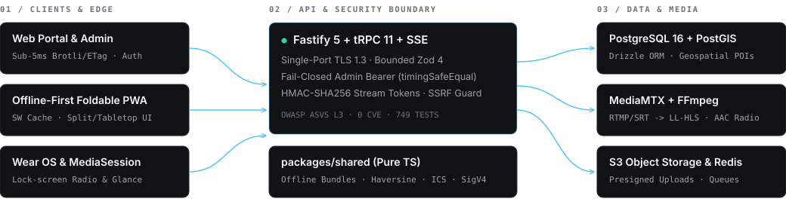

# Event & Streaming Platform — Architecture Overview

*Private repository — Ervice Oy (Helsinki, Finland)* · [Back to Profile](../README.md)

A multi-tenant TypeScript monorepo built for festivals, live music venues, and continuous radio broadcasts — designed to keep working reliably with zero cellular reception while supporting ticketed low-latency video streams.

<picture>
  <source media="(prefers-color-scheme: dark)" srcset="../assets/arch-event-platform-dark.svg">
  <source media="(prefers-color-scheme: light)" srcset="../assets/arch-event-platform-light.svg">
  
</picture>

## Pilot Scenarios

- **Festival (Offline-First):** Atomic event bundles with SHA-256 versioning and HTTP ETag `304 Not Modified`, Haversine POI distance filtering, schedule conflict detection, local reminders, and RFC 5545 `.ics` calendar export.
- **Live Venue (Ticketed Video):** Low-latency RTMP/SRT to LL-HLS streaming via MediaMTX, constant-time (`crypto.timingSafeEqual`) HMAC-SHA256 stream tokens, failover playback resolution, and zero-dependency AWS SigV4 presigned S3 uploads.
- **Live Radio (Background Audio):** Continuous AAC/Opus audio transcoding with real-time metadata, MediaSession lock-screen controls, and Wear OS glance state.

## Monorepo Layout & Engineering Standards

- **Backend (`apps/api`):** Fastify, tRPC, Zod, SSE live updates, Helmet, rate limiting, and Single-Port TLS Dual-Stack.
- **Database (`packages/database`):** PostgreSQL + PostGIS + Drizzle ORM with deterministic SQL migrations.
- **Web & Mobile (`apps/web`, `apps/mobile`):** In-memory Brotli/Gzip + ETag SSR cache on web; Service Worker offline-first foldable PWA (split-view and tabletop posture) on mobile.
- **Shared Core (`packages/shared`):** Pure TypeScript domain logic, validation schemas, and unit-tested security primitives.
- **Security Posture:** Fail-Closed Bearer authentication on all organizer/admin mutations, strict CORS allowlists, bounded request sizes, SSRF guards, and continuous automated test and audit verification.

*Source walkthroughs and live demonstrations are available during technical interviews.*
